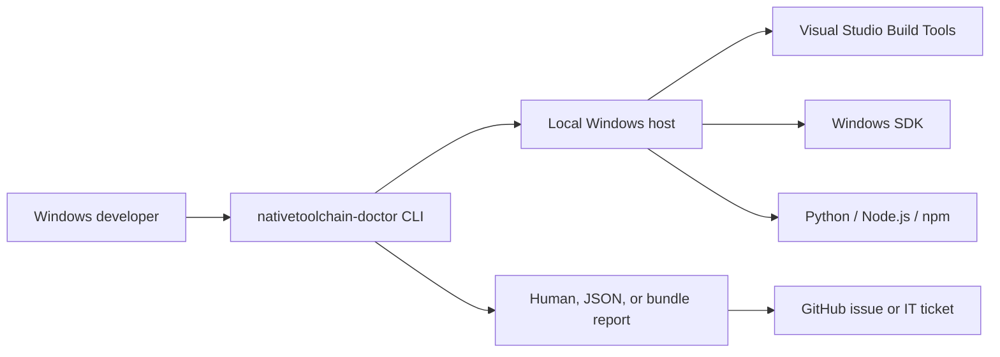
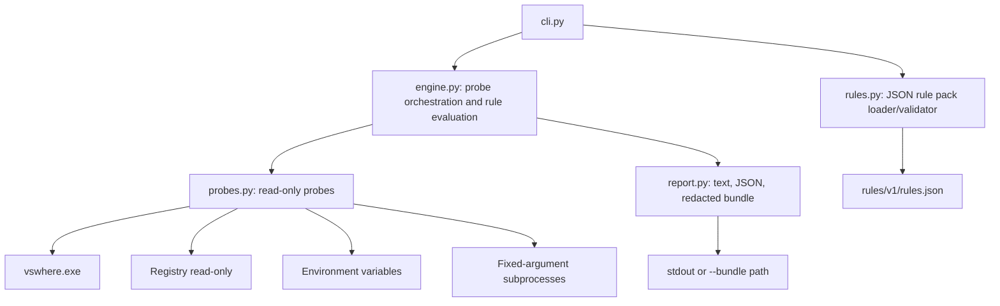

# ARCHITECTURE — nativetoolchain-doctor

Status: v0.1 architecture, 2026-10-23. Read-only by design.

## Context



The tool runs locally, makes no network requests, and never mutates the host. It reads existing installation state and produces a report.

## Containers and components



| Component | Responsibility |
|---|---|
| `cli.py` | Parse commands, load the rule pack, run the report, handle exit codes and the only write path. |
| `rules.py` | Read and validate JSON, enforce required fields, allowed probes, allowed expected types, unique IDs, and severity values. |
| `engine.py` | Execute each required probe once, evaluate expected values, count statuses, decide environment availability, and build fix lines. |
| `probes.py` | Read-only probes with injectable environment, process runner, executable lookup, and registry reader for tests. |
| `report.py` | Render human text, structured JSON, and a redacted Markdown support bundle. |

## Data model

```text
RulePack { rule_pack: string, rules: Rule[] }
Rule { id, name, probe, expected, severity, fix_hint }
ProbeResult { value: string, detail: string }
RuleResult { rule: Rule, status: pass|warn|error|info, detail, value }
Report { rule_pack, results: RuleResult[], environment_unavailable: bool }
```

No persistence. The rule pack is packaged data; the only generated artifact is an explicitly requested bundle file.

## Public interfaces

### CLI

```text
nativetoolchain-doctor run [--json] [--bundle PATH] [--dry-run]
nativetoolchain-doctor rules list
nativetoolchain-doctor doctor
nativetoolchain-doctor --rules PATH run
```

### Exit codes

| Code | Meaning |
|---|---|
| `0` | All rules pass. |
| `1` | At least one error-severity failure. |
| `2` | Warnings only. |
| `3` | Neither Visual Studio nor the Windows SDK was detected. |
| `4` | Rule pack cannot be read or validated. |

### JSON report shape

```json
{
  "tool": "nativetoolchain-doctor",
  "version": "0.1.0",
  "rule_pack": "2026.10.1",
  "platform": "Windows-...",
  "results": [
    {
      "id": "VS001",
      "name": "Visual Studio Build Tools with VC tools",
      "status": "pass",
      "severity": "error",
      "detail": "...",
      "fix_hint": "..."
    }
  ],
  "summary": { "pass": 11, "warn": 0, "error": 0, "info": 0, "exit_code": 0 },
  "fix_lines": ["..."]
}
```

`summary.exit_code` is the process exit code. `fix_lines` is empty when no actionable command is available.

### Rule-pack contract

A rule pack is a single JSON object with `rule_pack` and a non-empty `rules` list. A rule has:

- `id`: non-empty string, unique within the pack.
- `name`: non-empty string.
- `probe`: one of the fixed probe names in `probes.py`.
- `expected`: object with a supported `type` and its parameters.
- `severity`: `error`, `warn`, or `info`.
- `fix_hint`: non-empty string.

Invalid packs are rejected before any probe runs. There is no code execution, shell command, or arbitrary path loading from a rule pack.

## Probe behavior

| Probe | Source | Failure behavior |
|---|---|---|
| `vs_install_path` | `vswhere` with the VC tools component, then `VSINSTALLDIR`, then VS7 registry | Empty value with a detail; does not crash. |
| `vcvarsall_path` | Detected VS root and `VCINSTALLDIR` | Empty value if the file is absent. |
| `sdk_install` | SDK registry key, Kits registry key, then `WindowsSdkDir` | Empty value with a detail. |
| `sdk_version` | SDK `ProductVersion`, then versioned folders under `bin` | Empty value if unavailable. |
| `python_version`, `node_version`, `npm_version` | Fixed subprocess `--version` | Missing executable, timeout, or non-zero exit becomes an empty value with detail. |
| `msvs_version` | `npm config get msvs_version` | `undefined`, empty, or failure is treated as unset. |
| `sdk_env` | `WindowsSdkDir` when set | Empty means fallback is in use; invalid path becomes a warning. |
| `compile_env` | `INCLUDE` and `LIB` when set | Missing paths become a warning; never changed. |
| `cl_path` | Executable lookup for `cl`/`cl.exe` | Informational only. |

Environment lookup is case-insensitive so snapshots and Windows' mixed-case keys behave consistently.

## Security and privacy model

- **Read-only by construction:** no subprocess is a compiler or installer; no registry writes; no environment writes.
- **Fixed argv, no shell:** subprocess calls use a list and `shell=False`; no user-provided string is interpolated into a shell.
- **Timeouts:** every subprocess call has a timeout; timeouts are reported as probe detail.
- **Only one write path:** `--bundle PATH` writes a UTF-8 Markdown file at the user-specified path. A normal run creates no files.
- **Redaction:** bundles replace the current username, path segments that look like `C:\Users\<name>`, and token/password/API-key assignments. Plain `--json` is intentionally unredacted for scripting; use bundles for sharing.
- **No network:** no HTTP client, socket, update check, or telemetry.
- **Least privilege:** no administrator rights are requested or required.
- **Untrusted input:** rule-pack JSON is treated as data and validated; error messages quote configuration errors without executing content.

## Error model

- Probe failures are normal data, not exceptions: they produce empty values and details.
- A missing installation is an environment condition; if both Visual Studio and the SDK are absent, the report uses exit `3`.
- A bad rule pack is a configuration error and exits `4` before probing.
- An unwritable bundle path returns `3` and writes the diagnostic to stderr.
- Unexpected programming errors are not swallowed; tests cover malformed input and boundary cases.

## Performance budget

- Full run target: under 5 seconds on the reference host.
- Memory target: under 50 MB.
- The measured v0.1 result is recorded in [VERIFICATION.md](VERIFICATION.md).

## Testing strategy

| Level | Coverage |
|---|---|
| L0 | `ruff check`, `ruff format --check`, `mypy src`. |
| L1 | Rule loading/validation, expected-type evaluation, probe parsing, CLI wiring. |
| L2 | Fake `vswhere`, registry, environment, and subprocess outputs through injected context. |
| L3 | Live run against the build host; JSON summary and exact fix line. |
| L4 | Fresh-clone editable install and README quickstart. |
| L5 | Missing toolchain, invalid rule packs, non-UTF-8 rules, corrupt SDK env, huge environment, Unicode paths, read-only audit, redaction tests. |

## Packaging and distribution

- Source layout: `src/` layout with a `setuptools` build backend.
- Wheel includes `rules/v1/rules.json` as package data.
- Runtime dependencies: none outside the Python standard library.
- Development dependencies: pytest, ruff, mypy; recorded in `THIRD_PARTY_NOTICES.md`.
- Distribution target: PyPI after the publish gate; no registry upload has been performed.
- CI: Windows GitHub Actions matrix for Python 3.10, 3.11, and 3.12; live test job is manual because it depends on the runner's installed toolchain.

## Repository layout

```text
src/nativetoolchain_doctor/
  cli.py
  engine.py
  probes.py
  report.py
  rules.py
  rules/v1/rules.json
tests/
  unit/
  integration/
  security/
  adversarial/
  live/
docs/
  adr/
```
